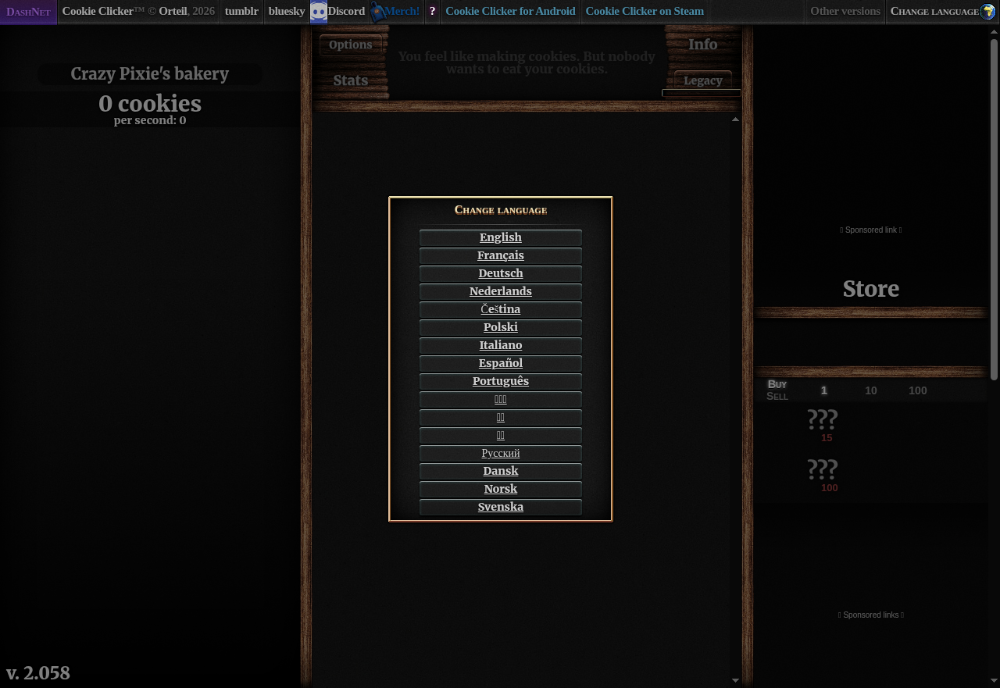
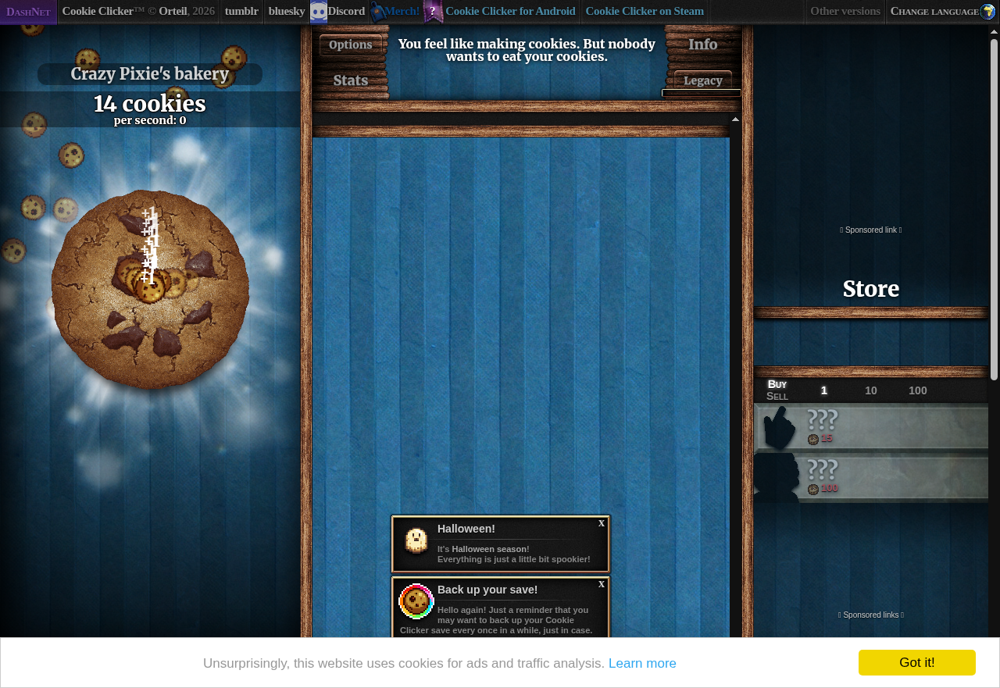
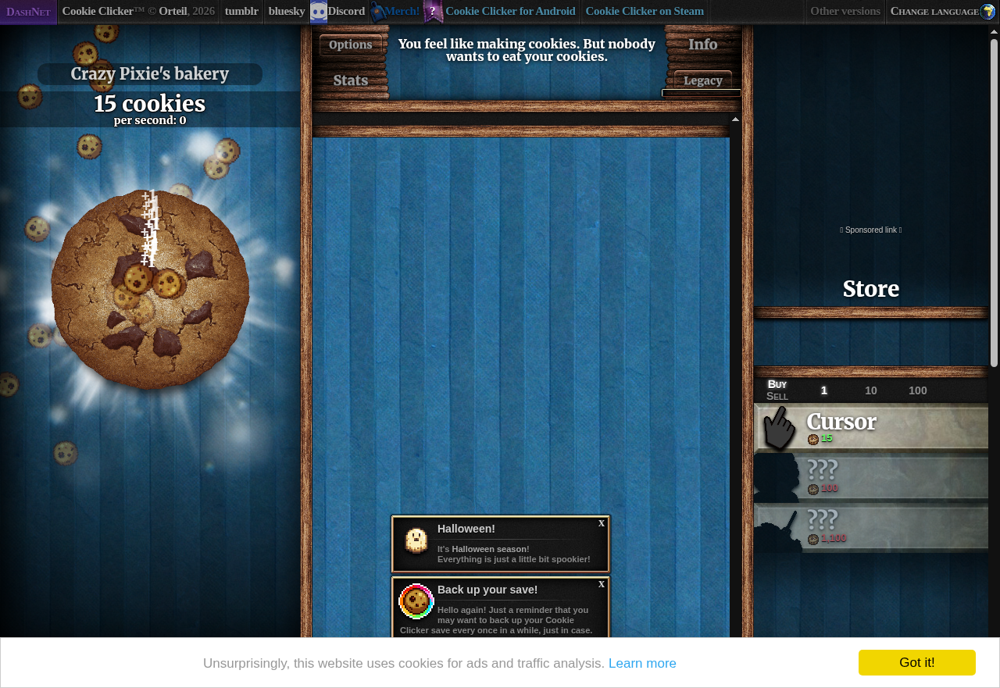
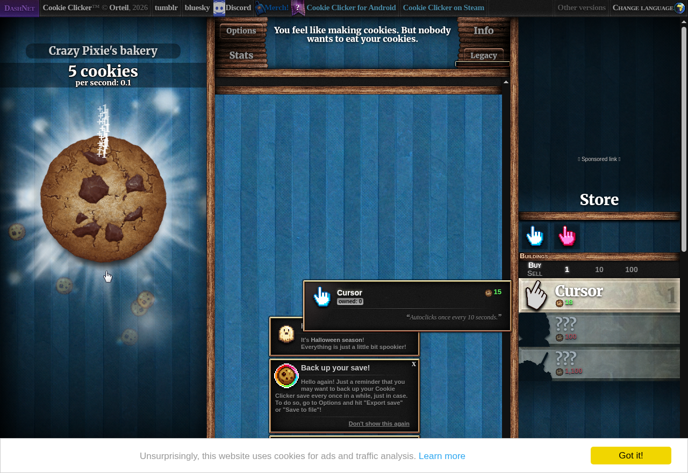
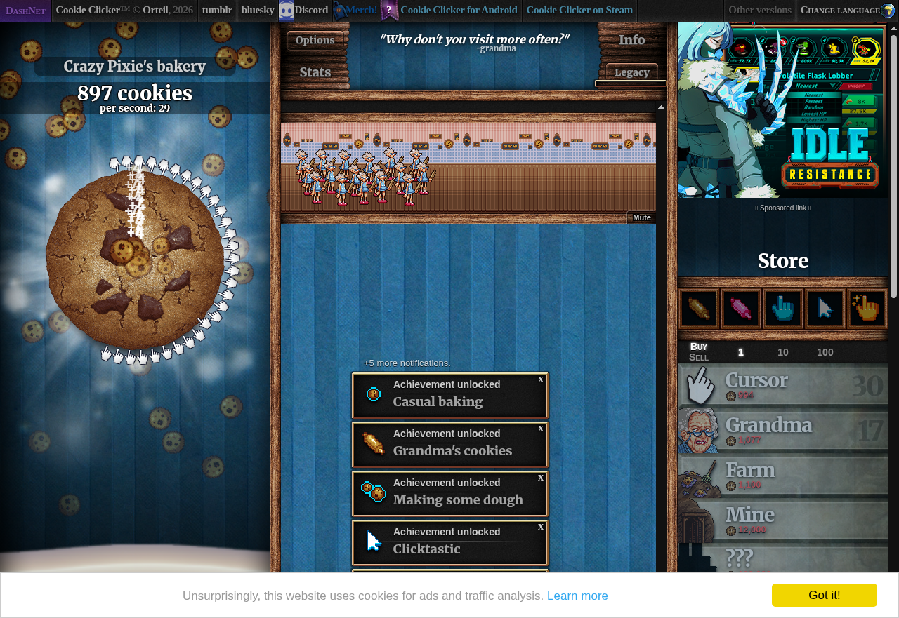

# 🚀 Cookie Clicker Bot

A Selenium bot that plays [Cookie Clicker](https://ozh.github.io/cookieclicker/) for five minutes: it clicks the big cookie, buys upgrades and reports its cookies per second (CPS). It is the day 48 project of Udemy's *100 Days of Code: The Complete Python Pro Bootcamp*, written to be read, run and compared by other course participants.

## 📚 Table of Contents

- [Overview](#-overview)
- [Requirements](#-requirements)
- [Setup](#-setup)
- [Run](#-run)
- [Tests](#-tests)
- [License](#-license)
- [Links](#-links)
- [Appendix: Project documents](#-appendix-project-documents)

## 🧭 Overview

The bot follows the five steps of the lecture. Every step is one function with the assignment's name, and every step has a screenshot taken by the bot itself in a headless Chromium inside Docker.

| Step | Function | What it does |
| --- | --- | --- |
| 1 | `open_game`, `select_language` | Opens the game and picks English |
| 2 | `click_cookie` | Clicks the big cookie |
| 3 | `get_cookie_count` | Reads the number of cookies |
| 4 | `get_store_items`, `choose_upgrade`, `buy_upgrade` | Buys the most expensive upgrade it can afford |
| 5 | `run_bot`, `get_cps` | Plays for 300 seconds and reports the CPS |

### Lecture step screenshots

**Step 1: open the game and choose a language**



**Step 2: click the big cookie**



**Step 3: read the cookie count**



**Step 4: buy the first upgrade**



**Step 5: the five-minute result**



In the run that made these screenshots the bot reached **29 cookies per second** after 300 seconds (the first release reached 16.6). Your number will differ: it depends on the speed of your machine and the network.

### Parts of the repository

| Folder | Holds |
| --- | --- |
| `src/cookie_clicker_bot/domain/` | Game rules without Selenium: number parsing and the purchase choice |
| `src/cookie_clicker_bot/application/` | The lecture step functions and the ports they need |
| `src/cookie_clicker_bot/infrastructure/` | The Selenium adapter and the clock |
| `src/cookie_clicker_bot/presentation/` | The command line entry points |
| `src/cookie_clicker_bot/constants.py` | All constants: address, element ids, timings |
| `tests/` | pytest tests that need no browser |
| `docker/` | The Docker image used for headless runs and screenshots |
| `docs/` | Project documents, screenshots and the wiki |

The only runtime dependency is `selenium`; a bot cannot drive a browser without it (see ADR-0001 in `docs/adr/`).

## 📋 Requirements

- Python 3.13 or newer.
- Google Chrome (Selenium Manager downloads the matching driver). Not needed to run the tests.
- Docker, only to repeat the headless run and the screenshots.
- Doxygen, only to build the API documentation.

## 🛠️ Setup

Create a local virtual environment, upgrade `pip` and install the project with its development tools.

Windows (PowerShell):

```powershell
python -m venv .venv
.venv\Scripts\Activate.ps1
python -m pip install --upgrade pip
python -m pip install -e ".[dev]"
```

Linux and macOS:

```bash
python3 -m venv .venv
source .venv/bin/activate
python -m pip install --upgrade pip
python -m pip install -e ".[dev]"
```

Leave the environment with `deactivate`. The `.venv` folder is ignored by git.

## ▶️ Run

With the virtual environment active, start the bot. A Chrome window opens and plays for five minutes, then the bot prints the CPS and closes the browser:

```bash
python -m cookie_clicker_bot
```

Useful options:

```bash
python -m cookie_clicker_bot --headless
python -m cookie_clicker_bot --duration 60
```

To repeat the headless run and the screenshots without touching your desktop, use Docker. The screenshots and a `steps.json` summary land in `runs/` (the ones in `docs/images/` came from such a run):

```bash
docker build -t cookie-clicker-bot -f docker/Dockerfile .
docker run --rm -v "$(pwd)/runs:/runs" cookie-clicker-bot --out /runs
```

To build the API documentation from the Doxygen comments, run `doxygen Doxyfile`; the result is in `docs/api/html/`.

## 🧪 Tests

The tests use fakes for the game and the clock, so they need neither Chrome nor the network:

```bash
python -m pytest
python -m ruff check src tests
python -m mypy src tests
```

## 📄 License

GNU Affero General Public License v3.0, see [LICENSE](LICENSE).

## 🔗 Links

- [Repository][repository]
- [Documentation][documentation]
- [Issue tracker][issues]

## 📎 Appendix: Project documents

The documents a newcomer needs, in reading order.

| Document | What it tells you |
| --- | --- |
| [AGENTS.md][agents] | The rules AI agents follow in this repository |
| [Business Case][BC-001] | Why the project exists, its scope and success criteria |
| [Stakeholder Analysis][SA-001] | Who is involved; the stakeholder IDs used for owners and reviewers |
| [Project Plan][PP-001] | The gateways and their schedule |
| [Milestones][milestones] | One document per gateway: Go/No-Go criteria and tasks |
| [ADR-0001][ADR-0001] | Why Selenium is the one runtime dependency |
| [Artifact registry][registry] | Where each artifact type lives, the next version, the PO language and domain |
| [Traceability matrix][TM-001] | How the artifacts link and when each was last reviewed |
| [Framework README][framework-readme] | The framework this project uses |
| [Framework changelog][framework-changelog] | What changed in each framework release |

---

[repository]: https://git.tirsystem.com/Tirsvad-Udemy-100-days-of-code/048-the-coockie-factory
[documentation]: https://git.tirsystem.com/Tirsvad-Udemy-100-days-of-code/048-the-coockie-factory/wiki
[issues]: https://git.tirsystem.com/Tirsvad-Udemy-100-days-of-code/048-the-coockie-factory/issues
[agents]: ./AGENTS.md
[BC-001]: ./docs/business-case.md
[SA-001]: ./docs/stakeholder-analysis.md
[PP-001]: ./docs/project-plan.md
[milestones]: ./docs/milestones/
[ADR-0001]: ./docs/adr/adr-0001-selenium-runtime-dependency.md
[registry]: ./docs/artifact-registry.md
[TM-001]: ./docs/sqa/traceability-matrix.md
[framework-readme]: ./framework/README.md
[framework-changelog]: ./framework/CHANGELOG.md
