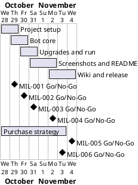

# Project Plan

## Metadata
| Key | Value |
| --- | --- |
| ID | PP-001 |
| CrossReference | [BC-001], [SA-001], [MIL-001], [MIL-002], [MIL-003], [MIL-004], [MIL-005], [MIL-006] |
| Language | en |
| Domain | it |

## Version History
| Date | Status | Author | Reviewer | Change | Commit |
| --- | --- | --- | --- | --- | --- |
| 2026-10-28 | Deprecated | Jens Tirsvad Nielsen | AI as stand-in for S01 | Initial version (reviewed in RC-003) | [96a9a78] |
| 2026-10-28 | Accepted | Jens Tirsvad Nielsen | AI as stand-in for S01 | Added MIL-006 purchase strategy improvement after the user asked for it in chat (reviewed in RC-015) | pending |

---

## Purpose

This plan schedules the six phases that deliver the Cookie Clicker bot inside the one-week limit of [BC-001].

## Planning Assumptions

- Week 1 starts 2026-10-28; the plan ends by 2026-11-04, per the Business Case constraint.
- Phase length: one to three days, one branch and one pull request per phase.
- S01 owns every phase; the AI acts as stand-in reviewer for S01 in autonomous mode, recorded in each review.
- The communication cadence of [SA-001] is one pull request per phase and a final summary.

## Gateway Schedule

| Gateway | Document | Window | Decision date | Owner | Stories | Main deliverable | Milestone |
| --- | --- | --- | --- | --- | --- | --- | --- |
| Project setup and tooling | [MIL-001] | 2026-10-28 to 2026-10-29 | 2026-10-29 | S01 | none (technical tasks) | pyproject, skeleton, .gitignore, Doxyfile, repository metadata | |
| Bot core | [MIL-002] | 2026-10-29 to 2026-10-30 | 2026-10-30 | S01 | none (technical tasks) | open_game, click_cookie, get_cookie_count with tests | |
| Upgrades and run | [MIL-003] | 2026-10-30 to 2026-10-31 | 2026-10-31 | S01 | none (technical tasks) | strategy, run_bot, main | |
| Screenshots and README | [MIL-004] | 2026-10-31 to 2026-11-02 | 2026-11-02 | S01 | none (technical tasks) | Docker run, screenshots, README | |
| Wiki and release | [MIL-005] | 2026-11-02 to 2026-11-04 | 2026-11-04 | S01 | none (technical tasks) | Wiki en, da, ms and final checks | |
| Purchase strategy improvement | [MIL-006] | 2026-10-28 to 2026-11-03 | 2026-11-03 | S01 | none (technical tasks) | Reliable store visits, upgrades bought, a higher CPS in Docker, README and wiki updated | |



## Scope Coverage

| Business Case scope item | Gateway |
| --- | --- |
| Bot for the lecture steps | MIL-002, MIL-003 |
| pyproject, .gitignore, .venv instructions, Doxyfile, constants.py | MIL-001, MIL-004 |
| pytest tests with a fake game | MIL-002, MIL-003 |
| Headless Docker run and screenshots | MIL-004 |
| README | MIL-004 |
| Wiki in en, da and ms | MIL-005 |
| Description and topics on the git host | MIL-001 |
| Higher CPS by a more reliable purchase strategy (objective O1) | MIL-006 |

## Dependencies

```
MIL-001 → MIL-002 → MIL-003 → MIL-004 → MIL-005 → MIL-006
```

MIL-006 was added after the first release; it runs beside the end of the window and must finish by 2026-11-03, one day before the end date.

A No-Go on a phase returns it to its owner for rework and moves every later gateway by the rework time; the end date 2026-11-04 moves only if S01 decides so and records the reason in Planning Assumptions. S01 is owner, reviewer and the only escalation point.

## Plan Risks

| Risk | Impact | Mitigation |
| --- | --- | --- |
| The live game changes or is unreachable during MIL-004 | Screenshots and the CPS run slip | Run the capture early in MIL-004; stop and report if it stays unreachable |
| Translation takes longer than planned | MIL-005 slips | Danish and Bahasa Malaysia follow the English page by page, with a short page set |
| Repository name differs from the one in the request | Metadata set on the wrong repository | Use the repository `origin` points to; reported in the plan summary |
| Token handling (Business Case risk: a token leaks) | Secret exposure | Tokens only read from `.env` by scripts outside the project, never printed |
| Live game changes (Business Case risk: page structure changes) | Bot breaks | Ids in `constants.py`; run the capture early in MIL-004 |
| The new strategy does not raise the CPS | MIL-006 returns No-Go | Measure after each change; keep the first release as the fallback |

## Open Issues

- The request names `https://git.tirsystem.com/Tirsvad-Udemy-100_days_of_code` (underscores); `origin` is `Tirsvad-Udemy-100-days-of-code/048-the-coockie-factory`. The plan applies description and topics to the `origin` repository.
- The Product Owner's earlier solution targeted the old Orteil page and used the extra package `continuous_threading`; this project reimplements it for the current game with one loop and no extra dependency.

## Traceability Analysis

### Business Goal Alignment

| Stakeholder | Concern | Business Case objective |
| --- | --- | --- |
| S01 | CN-001, CN-002, CN-007 | O1, O4 |
| S02 | CN-003, CN-004 | O2, O3, O4 |
| S03 | CN-005, CN-006 | O4, O5 |

## Sign-Off

| Stakeholder | Decision | Date |
| --- | --- | --- |
| S01 | Pending acceptance of this plan in chat | |

---

[BC-001]: ./business-case.md
[SA-001]: ./stakeholder-analysis.md
[MIL-001]: ./milestones/mil-001-project-setup.md
[MIL-002]: ./milestones/mil-002-bot-core-open-and-click.md
[MIL-003]: ./milestones/mil-003-upgrades-and-five-minute-run.md
[MIL-004]: ./milestones/mil-004-screenshots-and-readme.md
[MIL-005]: ./milestones/mil-005-wiki-and-release.md
[MIL-006]: ./milestones/mil-006-purchase-strategy.md
[96a9a78]: https://git.tirsystem.com/Tirsvad-Udemy-100-days-of-code/048-the-coockie-factory/commit/96a9a78f010ce8ae3fce8d84602317d8b5808a13
